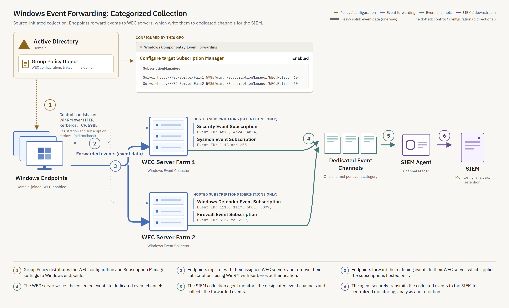

# Windows Event Forwarding: Categorized Collection
*A Collection Architecture for Scalable, Auditable Windows Telemetry*

---

| | |
|---|---|
| **Version** | 1.0 |
| **Author** | Shirish Mistry |
| | Associate Principal, Endpoint & Security Architecture |
| **Domain** | Endpoint Security, Detection & Monitoring |
| **Date** | November 2026 |
| **Repository** | github.com/Shirish03/windows-endpoint-security-patterns |

---

## Executive Summary

Windows Event Forwarding (WEF) is the built-in way to collect security
event logs from Windows endpoints onto central Windows Event Collector
(WEC) servers, with no third-party agent on each device. Most
deployments start the same way: one collector, one broad subscription,
and every forwarded event landing in the Forwarded Events log, where a
SIEM connector picks it up and sorts it out. It is the simplest design,
and it works until the fleet and the range of telemetry outgrow it.

When that happens, it looks like a capacity problem. In fact two
problems are mixed together, and this paper exists to keep them apart.
The first is capacity: one collector cannot serve the whole fleet. The
second is data organisation: authentication, process, script,
application-control, endpoint-protection and firewall events all share
one log and one path to the SIEM, so none of them can be scaled,
retained or troubleshot on its own. Adding servers fixes the first
problem and does nothing for the second.

This pattern fixes them separately. For capacity, the collection tier is
split across several collectors, and Group Policy decides which
organisational units (OUs) report to which collector. For data
organisation, each category of telemetry gets its own subscription that
writes to its own dedicated event channel, so events are separated when
they are collected and not sorted out later. Both fixes use only native
Windows components.

The design has costs, and this paper records them so the decision is
made with them in view. Custom channels need an instrumentation manifest
and a compiled resource DLL. Every collector in a group must stay
identical. Every subscription or suppression change touches the
collector, the channel, the SIEM agent and the SIEM. These costs are
accepted on purpose, and they belong in an architecture decision instead
of being found later by the team that runs the tier.

---

## 1. Background and Problem Context

### The default collection model

WEF works in one of two modes. In collector-initiated mode, the
collector contacts each source and keeps the list of sources. In
source-initiated mode, endpoints are told by policy where their
collectors are, fetch the subscriptions that apply to them, and push
matching events. This pattern uses source-initiated collection
throughout.

A WEC server has the usual Windows event logs plus the Forwarded Events
log, and everything forwarded to it lands there unless the collector is
extended. Leaving it that way is the easy path, with the SIEM connector
separating event types by subscription name or content. For a small
fleet and a few event sources, that is a sound design.

### Where it stops working

As endpoints are added and more telemetry is collected, very different
kinds of event compete for the same collector CPU, disk, log and
ingestion path. Noisy sources and quiet, high-value sources are handled
together. The tier gets hard to scale and hard to troubleshoot.
Eventually the operator stops asking whether collection is healthy and
starts asking what inside Forwarded Events is causing today's problem.
That change in the question is the sign that the limit is architectural
and no longer a tuning matter.

### Four problems that look like one

A categorized collection tier is rarely designed in one go. It usually
grows out of a sequence of problems that are easy to mistake for each
other.

**Capacity.** One collector cannot keep up. Before buying hardware,
there is usually volume to cut at the source by suppressing verified
low-value events. Because suppression decides what is never collected,
it is agreed with the people who use the telemetry for detection. It
helps, and it does not remove the limit.

**Delivery mechanism.** A source such as Sysmon needs frequent tuning,
and if its configuration is tied to its binary, every change means a
redeploy. That has nothing to do with collector capacity and is covered
in a separate pattern (see Section 7).

**Distribution.** With noise reduced, one collector still cannot serve
the whole fleet, so the fleet is spread across several collectors by
policy. The collectors are still carrying the same mixed data, just on
more servers.

**Data organisation.** With one common subscription per collector,
everything arriving is a mixed stream, and parsing and triage downstream
are imprecise. This problem often comes to light through an unrelated
change, such as a change of downstream platform, which forces a choice
between copying the old design and fixing the deeper limit.

This paper focuses on the last two, which carry the architectural
decision: distribution, which is the capacity fix, and data
organisation. The mistake to avoid is treating all four as one problem
and answering each with the same reflex, which is to add more servers.

---

## 2. Risk and Compliance Implications

### Telemetry collection as an operating control

Auditors, assurance reviews and incident responders depend on security
event collection all the time. Monitoring and audit frameworks generally
treat it as either operating or not, and not as something satisfied by
being set up correctly once. Detection rules, investigations and
evidence all sit downstream of it, so a gap in collection is inherited
by everything built on top.

### Three risks of the single-log model

**Detection coverage.** When one collector carries a mixed workload, a
performance problem in one category affects all of them. A collector
that struggles under load, or a channel that fills faster than the
downstream agent drains it and starts to roll over, can lose events
before they are ingested. In large enterprise environments, this is the
failure that most often prompts a redesign: collector performance
degrades and becomes unstable when a large volume of telemetry is pushed
through one common collection path.

**SIEM ingestion.** Parsing, tuning and onboarding are harder against a
mixed stream. Low-volume, high-value events such as authentication or
application-control decisions arrive next to high-volume process and
network telemetry. A parsing or filtering problem with one class can
hide another, and there is little visibility into the health of each
stream.

**Evidence integrity.** With unclassified streams, it is hard to show
for a given category what was collected, what was suppressed and why.
Suppression removes security data before it is ever collected, so one
that is undocumented or unreviewed is a silent loss of evidence. Without
a clear map from subscription to channel to collector, an assessor has
no single place to look.

### Healthy-looking is not the same as healthy

A subscription can report active source computers while events are not
reaching the downstream platform. Runtime status alone is weak evidence
that collection works. An assessor who stops at "the subscription is
active" has not verified the control. Verification means following
events from the endpoint through the channel and the collection agent
into the SIEM.

### Why this is a compliance concern, not only an operational one

Most frameworks an organisation is measured against expect security
event logging to be continuous, complete enough to support
investigation, and under change control. A collection tier that cannot
show completeness per category, and does not record its suppression
decisions, sits awkwardly against those expectations however an
organisation's own obligations are framed. In the environments this
pattern was designed for, a telemetry change is an operational change,
and this architecture makes those changes traceable.

This document does not constitute legal or compliance advice;
organisations should assess applicability to their specific obligations.

---

## 3. Architecture Overview

### Two fixes for two problems

The architecture answers capacity and data organisation separately.

**Fix 1: capacity, by splitting collectors by OU.** Instead of every
endpoint reporting to one collector, the tier is spread across several.
One Group Policy setting, the Subscription Manager configuration, tells
endpoints where their collectors are. Separate Group Policy Objects,
each with a different collector address, are linked to different OUs, so
the endpoints in each OU register with a specific collector or collector
group. The fleet is balanced by policy. Endpoints need no per-device
changes when they join, leave or are rebuilt, and no collector keeps a
list of endpoints.

**Fix 2: data organisation, by category and channel.** Each category of
telemetry gets its own subscription, and each subscription writes to its
own dedicated custom event channel on the collector, instead of the
shared Forwarded Events log. Authentication, process activity, script
execution, endpoint protection and firewall events each land in a
separate place with their own size, retention and name. The SIEM agent
reads those named channels and no longer has to sort a mixed stream.

The fixes are independent. Splitting collectors without separating
categories gives more servers carrying the same mixed stream. Separating
categories on one collector gives tidy channels on a server that is
still the bottleneck. A mature design does both.

### How events flow

The numbered stages match the diagram.

1. **Policy.** Group Policy gives endpoints the Subscription Manager
   configuration, which holds the collector address and settings.
2. **Registration.** Endpoints register with their assigned collectors
   and fetch their subscriptions over WinRM with Kerberos
   authentication.
3. **Forwarding.** Endpoints forward the events that match their
   subscriptions to the collector.
4. **Storage by category.** The collector writes the events to dedicated
   event channels, one per category.
5. **Collection.** The SIEM collection agent reads the designated
   channels.
6. **Transmission.** The agent securely sends the events to the SIEM for
   monitoring, analysis and retention.

*Figure 1 — Categorized collection architecture. Group Policy tells
endpoints which collectors to use; each collector hosts category
subscriptions that write to dedicated channels, and the SIEM agent reads
those channels by name.*

### Two axes of separation

The first axis is category, meaning what kind of event it is.
Authentication, process, script, application-control,
endpoint-protection and network telemetry differ in volume, value and
retention needs, so each gets its own subscription and channel. The
second axis is collector group, meaning which collectors handle it.
Grouping collectors by telemetry domain draws boundaries around faults:
a volume spike or maintenance action in one domain uses up that group's
resources and not the whole tier's.

The two axes do not always line up. Categories differ in volume by more
than an order of magnitude, and grouping purely by category can put two
very heavy categories on one group while another sits lightly loaded. A
sound grouping takes volume into account: category shapes the design and
volume limits it.

### Component roles

| Component | Role |
|---|---|
| Group Policy | Delivers the Subscription Manager setting; scoping by OU decides which endpoints use which collector group |
| Windows endpoints | Register with their assigned collectors, fetch subscriptions and forward matching events |
| Collector groups | Host the subscriptions for a coherent set of telemetry categories; each group is scaled and maintained on its own |
| Category subscriptions | Define what is collected and what is suppressed for one category, and name the channel the events land in |
| Dedicated event channels | One log per category on the collector, with its own size and retention; registered through a manifest and a compiled resource DLL |
| SIEM collection agent | Reads the named channels and sends the events to the SIEM |

The manifest structure, subscription queries, suppression patterns and
Group Policy paths are in the
[GitHub pattern](https://github.com/Shirish03/windows-endpoint-security-patterns/tree/main/patterns/windows-event-forwarding-categorized-collection).

---

## 4. Design Rationale

### Classify upstream

One principle explains most of the decisions here: classify, assign
ownership and control operations as early in the pipeline as possible.
With a shared log, the order is collect, store, then classify
downstream. With dedicated channels, it is collect, classify, then
store. That one change makes independent scaling, per-category
retention, fault isolation and clean SIEM onboarding possible. A noisy
or malformed source stays inside its own channel, and the SIEM agent
subscribes to named channels instead of separating mixed events after
the fact.

### Select broadly, suppress precisely

Separation is half of the volume story. The other half is removing
verified benign activity at the subscription, before it is collected.
Each subscription selects the potentially valuable events broadly, then
removes specific, baselined, known-benign activity with targeted
suppression. Suppression is treated as security configuration. Each
exclusion is baselined, documented with a reason and an owner, reviewed
with the people who use the telemetry for detection, and rechecked after
significant operating system, agent or application changes.

### Source-initiated collection driven by Group Policy

Source-initiated collection scales better as endpoints are added, and it
suits an environment that already uses Group Policy for control. Devices
that join, leave or are rebuilt need no change on the collector. Group
Policy already handles targeting, lifecycle and refresh, so the design
adds no new software and no third-party dependency.

### A small number of collector groups

One group recreates the original shared-workload problem. A group for
every category gives maximum isolation but multiplies servers,
subscriptions, monitoring, failover design and documentation. A small
number of groups, each owning a coherent set of categories, gives real
isolation and independent scaling while staying manageable for a support
team and not only for the people who designed it.

### Costs accepted

A design that lists only benefits is an advertisement, not an
architecture. This one accepts several costs on purpose.

- **More moving parts.** Custom channels, several subscriptions,
  collector groups, manifest registration and per-channel settings
  replace one shared log.
- **Manifest maintenance.** The instrumentation manifest, its compiled
  DLL and the channel definitions need version control. Channels are
  grouped under providers with a limit per provider, so a large design
  has to spread its channels across several providers.
- **Configuration consistency.** Every collector in a group must have
  the same channels, subscriptions and retention. Drift between
  collectors causes unpredictable behaviour.
- **A larger testing surface.** Every subscription change touches the
  collector, channel, agent and SIEM.
- **Documentation as part of the solution.** The map from subscription
  to channel to collector has to be written down, because no single log
  explains the design.

### What was considered and rejected

**Adding more general-purpose collectors.** More identical collectors,
each receiving every category, add capacity and leave the architecture
as it was. A noisy category still affects every collector, and a change
to one category still touches all of them. The goal is also to isolate
workload, troubleshooting and ingestion, and collectors aligned to
telemetry domains create the boundaries that raw capacity does not.

**Staying on Forwarded Events with downstream filtering.** This is the
simplest model, and a legitimate one. It avoids the manifest, the
compiled DLL and the drift concerns that custom channels bring. This
pattern goes the other way because a change of downstream platform
exposed a limit. With all telemetry arriving through one collection
point, ingestion, parsing, tuning, troubleshooting and visibility all
got harder. Separating the streams at collection reduced the work
downstream and gave clear boundaries between telemetry types. A
deployment whose downstream platform already separates a shared log
cleanly by subscription may weigh this differently, and that is
reasonable.

**Collector-initiated collection, or one collector per category.** The
first works in small environments but moves lifecycle management onto
the collector as the fleet grows. The second gives the most isolation
and ends in collector sprawl with little extra benefit.

---

## 5. Operational Considerations

Full guidance on validation, failure modes and change control is in the
[Operational Guidance
section](https://github.com/Shirish03/windows-endpoint-security-patterns/tree/main/patterns/windows-event-forwarding-categorized-collection#operational-guidance)
of the GitHub pattern. Four points matter most to the people accepting
this design.

**Plan capacity per deployment.** Collector capacity depends on the
number of sources, the number and complexity of subscriptions, and the
I/O the channels can sustain. Limits on concurrent sources are usually
reached before hardware limits and change with subscription complexity,
so they are measured and not assumed. Channels are sized per category,
because one size for all wastes space on light categories and starves
heavy ones.

**The downstream side has to keep pace.** If the agent draining a
channel falls behind, the channel fills and rolls over, and events can
be lost before they are ingested. A channel filling faster than it
drains needs investigating, and the runtime status of a subscription
will not show it.

**Validate the whole path.** Health is checked at four points: the
endpoint, where policy and forwarding activity are visible; the
collector, where each subscription is active and has sources; the
channel, where events land in the right place and not in Forwarded
Events; and the SIEM, where each category arrives as its own stream.
Subscription status alone is not accepted as proof of healthy ingestion.

**Treat changes as operational changes.** A new or altered subscription
is validated across the collector, channel, agent and SIEM. Suppression
changes carry extra weight and are baselined, documented with an owner
and rechecked after platform changes. A rebuilt collector registers the
manifest again and re-creates its subscriptions, so it rejoins its group
identically.

---

## 6. Recommendation

Organisations that collect Windows security telemetry with WEF, and have
outgrown or expect to outgrow a single collector writing to Forwarded
Events, should treat capacity and data organisation as two problems with
two fixes. Split the collection tier by OU through Group Policy to
address capacity. Use category-based subscriptions that write to
dedicated custom channels to address data organisation. Group collectors
by telemetry domain, and let volume limit that grouping.

The extra manifest, consistency and testing work is real. Accept it as a
recorded architecture decision, with named owners for the manifest, the
subscription-to-channel map and the suppression review. Where the
downstream platform already separates a shared log cleanly by
subscription, staying on Forwarded Events is a defensible choice. Where
ingestion, troubleshooting and per-category control are already hard,
adding collectors will not change that, and the data-organisation fix
will.

Whichever design is chosen, validate collection from the endpoint
through to the SIEM. A collection tier whose health can only be assumed
is a control that cannot be shown to be operating.

---

## 7. Further Reading

**GitHub pattern: full implementation reference**
The complete implementation, including the instrumentation manifest and
build steps, category-based subscriptions, suppression patterns, Group
Policy configuration, and operational guidance, is available at:
github.com/Shirish03/windows-endpoint-security-patterns/tree/main/patterns/windows-event-forwarding-categorized-collection

**Related pattern**
- Sysmon configuration via native policy: decoupling configuration
  delivery from binary redeployment, a natural upstream companion where
  Sysmon is one of the collected categories

**Microsoft documentation**
- Microsoft Learn: Windows Event Forwarding and intrusion detection
- Microsoft Learn: Configure computers to forward and collect events
- Microsoft Learn: `wecutil` and `wevtutil` command references
- Microsoft Learn: Event logging, instrumentation manifests and event
  channels
- Microsoft Learn: Group Policy settings for Event Forwarding

*Reference Microsoft documentation at learn.microsoft.com. Content and
URLs are subject to change; search by topic rather than direct URL.*

---

## 8. Disclaimer

This whitepaper is provided as reference material and architectural
guidance. The design described has been validated with Windows Server
2016 and Windows Server 2019 collectors and with endpoints from Windows
10 version 1507 through Windows 11 24H2, using HTTP transport with
Kerberos authentication and a commercial SIEM collection agent reading
the dedicated channels. Nothing in the design depends on a specific SIEM
agent. HTTPS (certificate) transport and later Windows Server releases
have not been validated and should be confirmed in any pilot.

There is no guarantee that this approach will function identically in
all
environments. Administrators should review, test, and validate behaviour
in a controlled setting before any production use. Command syntax, event
IDs, log channel names, and tool behaviour vary across Windows versions
and toolchains.

This document does not constitute legal or compliance advice.
Organisations should assess applicability to their specific regulatory
and contractual obligations independently.

Use at your own discretion.

