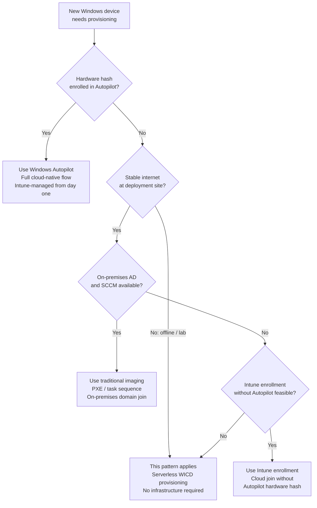

# Serverless Windows Provisioning with WICD

---
**Jump to section:**
[Strategic Overview](#strategic-overview) ·
[Architecture & Design](#architecture--design) ·
[Implementation Reference](#implementation-reference) ·
[Operational Guidance](#operational-guidance)

---

## Strategic Overview

### Who Should Read This

This document serves two audiences. Security architects and IT leadership
will find the strategic context, risk framing, and architectural
recommendation in this section. Engineers responsible for deploying and
operating the solution should proceed to
[Architecture & Design](#architecture--design) for design rationale,
[Implementation Reference](#implementation-reference) for deployment
steps, and [Operational Guidance](#operational-guidance) for monitoring
and failure handling.

---

### The Problem in Plain Terms

Not every organization can adopt cloud-native provisioning immediately.
SMB environments, regulated environments with network restrictions,
offline deployment scenarios, and organizations in transitional states
all need a secure provisioning path that does not depend on deployment
infrastructure, cloud connectivity, or pre-registered hardware hashes.

When no lightweight official path exists, the practical outcome is
inconsistent provisioning: devices set up manually, with varying
security baselines, by whoever is available. The risk is not that the
wrong tool is used; it is that no governed process exists at all.

---

### Risk and Compliance Implications

**Security baseline gaps**
Unprovisioned or inconsistently provisioned devices enter the estate
without verified encryption, policy application, or configuration
baselines. Each manually provisioned device is a potential gap that may
not be detected until an audit or incident surfaces it.

**Autopilot dependency as a single point of failure**
Environments that have consolidated onto Autopilot without a fallback
provisioning path face a gap when devices cannot be pre-registered,
when cloud connectivity is unavailable at the deployment site, or when
the Autopilot service is degraded. Without an alternative, devices
either go unprovisioned or are set up outside any governed process.

**Shadow IT provisioning**
When no official lightweight provisioning path exists, teams find their
own. USB-based re-imaging, manual setup, or community scripts fill the
gap, without the security controls, audit trail, or change management
that a governed provisioning approach provides.

**Why this matters beyond convenience**
Consistent, verifiable device configuration at the point of provisioning
is treated as a baseline security control requirement in most audit and
compliance programs, independent of which framework an organization
follows. A provisioning process that varies by technician or by
deployment scenario cannot produce a consistent, auditable baseline, and
a versioned, signed provisioning package is a directly auditable
configuration artifact in a way ad hoc setup never is. This document
does not constitute legal or compliance advice; organizations should
assess applicability to their specific regulatory and contractual
obligations independently.

---

### Architectural Recommendation

Native Windows tooling provides a viable, secure provisioning path without
infrastructure dependency for environments where Autopilot or SCCM are not
feasible. Windows Imaging and Configuration Designer (Windows ICD) builds a
customized Windows image on bootable USB media. A provisioning package made in
the same tool applies the join, enrollment, certificate, and Wi-Fi settings
after the image is installed, and a custom script backs up the BitLocker
recovery key. The approach uses only platform-native mechanisms, with no
deployment servers, imaging servers, or long-running agents.

---

## Architecture & Design

### Background

Provisioning Windows devices is often framed as a binary choice:

1. Traditional imaging infrastructure (servers, AD, SCCM)
2. Fully cloud-native provisioning (Autopilot, Intune)

In reality, many environments sit in between, or intentionally avoid
adding infrastructure. Conventional provisioning assumes deployment
servers, directory services, and persistent management infrastructure,
none of which may exist in these scenarios.

This pattern demonstrates how to provision devices securely and
consistently using only the platform's native capabilities, without
deployment servers, imaging servers, or long-running agents.

---

### When to Use This Pattern



> For fully cloud-managed deployments (Entra ID + Intune), Autopilot
> remains the preferred approach. WICD provides value for offline or
> constrained setups, or when bulk provisioning without backend services
> is required.

---

### How It Works

The flow has two stages: an image is built once, then provisioning runs on each
device after the image is installed.

1. A customized Windows 10 image is built in Windows ICD (Windows image
   customization). Image-time settings are baked into the image when it is built
2. The image is written to a bootable USB drive (Create > Clean install media,
   WIM format)
3. The device boots from the USB drive and the image installs
4. The provisioning package is kept on the same USB drive, so nothing is
   delivered over the network. After the OS installs, the device detects the
   package on the USB media and provisioning runs: the device joins Azure AD (now Microsoft Entra ID)
   and enrolls in Intune, and the baseline applications install. A provisioning
   package made in the same tool delivers the certificate and Wi-Fi profile
5. A custom script triggers the BitLocker recovery key backup to Azure AD
6. The device reaches a compliant and usable state without manual
   intervention. In the lab, the whole sequence from boot to key backup took
   about 11 minutes

> No deployment servers · No imaging servers · No long-running agents

---

### Security Design Principles

| Principle | Description |
|---|---|
| **Recovery key backup at provisioning** | A custom script backs up the BitLocker recovery key to Azure AD as part of provisioning, so the device is recoverable before it is issued |
| **No embedded credentials** | No secrets or credentials are stored in provisioning package artifacts |
| **Platform-native trust** | All security controls operate within Windows security boundaries |
| **Provisioning as a security control** | Configuration is treated as a security artifact, not just a setup convenience |
| **No persistent agents** | The provisioning mechanism does not require long-running software after setup completes |

---

### Design Trade-offs and Alternatives Considered

**Why WICD rather than manual setup?**
Manual setup is inconsistent by nature; each technician makes
different choices, and there is no audit trail for the configuration
applied. WICD packages define configuration as code, applied
deterministically at every provisioning event.

**Why not Autopilot for all scenarios?**
Autopilot requires hardware hash pre-registration, internet connectivity
at enrollment time, and an active Intune subscription with appropriate
licensing. For offline deployments, lab environments, or organizations
not yet on Intune, these dependencies are not always satisfiable. WICD
provisioning has none of them.

**Limitations of this approach**
WICD provisioning packages apply configuration at setup time and do not
provide ongoing management. For continuous compliance enforcement,
Intune enrollment following initial provisioning is recommended where
feasible.

**Tooling availability**
This pattern was built with the Windows ADK for Windows 10 version 1607. The
image customization option used here may not exist in current ADK or Windows
Configuration Designer releases, whose documentation describes provisioning
packages. Confirm what your version offers before reusing the flow.

---

## Implementation Reference

### Environment Requirements

| Requirement | Detail |
|---|---|
| **Windows ADK** | Windows ADK for Windows 10 version 1607 (10.1.14393.8069) with Windows Imaging and Configuration Designer installed on the authoring machine |
| **Target OS** | Windows 10 version 1607, the build this pattern was tested on. Later builds, including Windows 11, have not been validated against this flow |
| **USB media** | USB drive of 8 GB or more (NTFS). Building the media wipes and reformats it |
| **Entra ID** | Required for the Azure AD join and Intune enrollment during provisioning; the device must be able to reach it at that point |
| **Authoring machine** | Any Windows 10/11 machine with ADK installed; does not need to be domain-joined |

---

### Building the image and provisioning package

**1. Install the ADK with Windows ICD**

Install the Windows ADK for Windows 10 version 1607 and its Windows Imaging
and Configuration Designer component on the authoring machine.

**2. Create a Windows image customization project**

In Windows ICD, choose Windows image customization. Set the image-time
settings, which are baked into the image, and the runtime settings, which
are applied after installation.

**3. Create the provisioning package**

In the same tool, make a provisioning package for the Azure AD join, Intune
enrollment, certificate, and Wi-Fi settings. Sign the package if the
environment requires signed provisioning packages (recommended for
production use). Record the package version in the filename. See
[Operational Guidance → Package Versioning](#package-versioning).

**4. Add the BitLocker backup script**

Include the custom script that triggers the BitLocker recovery key backup to
Azure AD, so it runs as part of provisioning.

**5. Build the bootable USB drive**

Format a USB drive of 8 GB or more as NTFS and connect it to the authoring
machine. In the image project, choose Create > Clean install media, select
WIM as the image format, choose Create a bootable USB drive, select the
removable drive, and finish the wizard. The drive is wiped and reformatted.

**6. Keep the provisioning package on the same USB drive**

Place the signed `.ppkg` on the bootable USB drive. In the tested build, the
device detected the package on the install media automatically after the OS
installed, with no network delivery and no manual step to apply it.

---

### Validation

After provisioning completes, verify the following on the device before
handing it to the end user:

**BitLocker status**
```powershell
Get-BitLockerVolume -MountPoint C: |
    Select-Object MountPoint, VolumeStatus, ProtectionStatus, EncryptionPercentage
```
`ProtectionStatus` should be `On` and `VolumeStatus` should be
`FullyEncrypted` or `EncryptionInProgress`.

**Entra ID join status**
```powershell
dsregcmd /status | Select-String "AzureAdJoined"
```
Should return `AzureAdJoined : YES`.

**Provisioning package application**
```powershell
Get-WinEvent -LogName "Microsoft-Windows-Provisioning-Diagnostics-Provider/Admin" |
    Select-Object TimeCreated, Message -First 20
```
Review for any provisioning errors during the provisioning stage.

---

### Repository Contents

| File | Purpose |
|---|---|
| `docs/provisioning-flow.md` | Step-by-step walkthrough of the flow from image and package creation through provisioning to first login; includes per-component runtime behavior notes and failure handling |

---

## Operational Guidance

### Package Versioning

Provisioning packages should be versioned explicitly in the filename to
prevent ambiguity when multiple versions exist across deployment USB
drives and file shares.

Recommended naming convention:

```
WICD-Provisioning-v<major>.<minor>-<YYYYMMDD>.ppkg
```

Example: `WICD-Provisioning-v1.3-20260601.ppkg`

Maintain a version log recording what changed in each release, who
approved the change, and which devices were provisioned with each
version. When a new package is produced, retain the previous version
for at least one provisioning cycle to support rollback.

---

### Provisioning Failure After Image Install

If provisioning fails after the image installs, the device may boot to a
working desktop without being joined, enrolled, or recoverable. Common causes:

| Symptom | Likely cause | Resolution |
|---|---|---|
| Package not detected after install | `.ppkg` missing from the USB drive, or the drive was removed before provisioning started | Confirm the package is on the media and leave the drive attached until provisioning finishes |
| Image does not boot from USB | USB not built as bootable media; boot order or firmware settings | Rebuild with Create > Clean install media and check boot settings |
| Provisioning package settings not applied | ADK version mismatch; package targets wrong OS edition or architecture | Re-author with the matching ADK version |
| Azure AD join or Intune enrollment fails | No network connectivity; tenant configuration issue | Join manually post-setup via Settings |
| Certificate or Wi-Fi profile missing | Package settings incomplete or package not applied | Check the provisioning diagnostics log and re-apply the package |
| BitLocker key not in Azure AD | Script did not run or device had no connectivity; TPM not ready | Check TPM status and connectivity, then re-run the backup script |

To re-apply a provisioning package after a failed run:

```powershell
Install-ProvisioningPackage -PackagePath "D:\WICD-Provisioning-v1.3-20260601.ppkg" -QuietInstall
```

---

### Physical Security for USB Distribution

The provisioning USB is a sensitive artifact; it defines the security
baseline for every device it touches. Treat it accordingly:

- Maintain a physical log of how many USBs have been produced, who
  holds each one, and which devices were provisioned from each
- Do not leave provisioning USBs unattended or in shared spaces
- If a provisioning USB is lost, treat it as a security event: assess
  what configuration it contained, whether it included certificates or
  sensitive policy settings, and whether devices provisioned from it
  need to be reviewed
- Retire USBs when a new package version is released; do not allow
  outdated package versions to remain in circulation

---

### Validating a Successfully Provisioned Device

Immediately after setup completes, verify the following before the
device leaves the provisioning environment:

| Check | Command or location | Expected result |
|---|---|---|
| BitLocker enabled | `Get-BitLockerVolume C:` | ProtectionStatus: On |
| Entra ID joined | `dsregcmd /status` | AzureAdJoined: YES |
| Recovery key escrowed | Entra ID portal → Devices → BitLocker Keys | Key present for device |
| Provisioning log clean | Event Viewer → Provisioning-Diagnostics-Provider | No errors |
| Certificate installed | `Get-ChildItem Cert:\LocalMachine\My` | Expected certificate present |
| Wi-Fi profile present | `netsh wlan show profiles` | Expected profile listed |
| Network connectivity | `Test-NetConnection` to known endpoint | Success |

Any failed check should be investigated and resolved before the device
is issued. A device that passes all checks has a confirmed baseline and
a recoverable encryption state.

---

### Dependencies

| Dependency | Notes |
|---|---|
| Windows ADK with Windows ICD | Required on the authoring machine only; not installed on provisioned devices; this flow used the ADK for Windows 10 version 1607 |
| TPM | Required for BitLocker encryption and key backup; devices without a functional TPM will not encrypt |
| Entra ID connectivity | Required during provisioning for the Azure AD join, Intune enrollment, and key backup; devices provisioned offline must complete those steps manually afterward |
| Signed provisioning package | Recommended for production use; unsigned packages may trigger a prompt or be blocked by policy |
| Bootable USB drive | Built from the image project with Create > Clean install media. It is wiped and reformatted when built, so copy the `.ppkg` onto it afterward and keep other source files elsewhere |

---

## Related Patterns

- **[BitLocker-to-Go Recovery Key Escrow](https://github.com/Shirish03/windows-endpoint-security-patterns/blob/main/patterns/hybrid-entra-btg-key-escrow-pattern)**: this pattern triggers the initial recovery key backup to Azure AD, through a custom script, during provisioning. That pattern is the compensating control for the same escrow mechanism later in the device's life, when a user encrypts a removable drive with BitLocker-to-Go and that specific escrow path fails silently.
- **[SCEP Certificate Enrollment via Internal NDES](https://github.com/Shirish03/windows-endpoint-security-patterns/blob/main/patterns/scep-certificate-enrollment-internal-ndes)**: a device provisioned here completes Entra ID join during provisioning. When that join is Entra ID Join Only rather than Hybrid, a realistic outcome for offline or infrastructure-light provisioning, the resulting device is exactly the population that pattern's certificate enrollment was built for.

---

## Disclaimer

This pattern is provided as reference material and design guidance. It
was built when Windows Autopilot was still in development and tested
in offline and infrastructure-light lab scenarios on Windows 10
version 1607. Behavior on later Windows builds has not been validated,
and provisioning package behavior may vary depending on Windows ADK
version, hardware configuration, and target OS build.

Validate all provisioning packages in a controlled test environment
before deploying to production devices.
